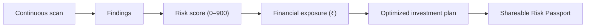
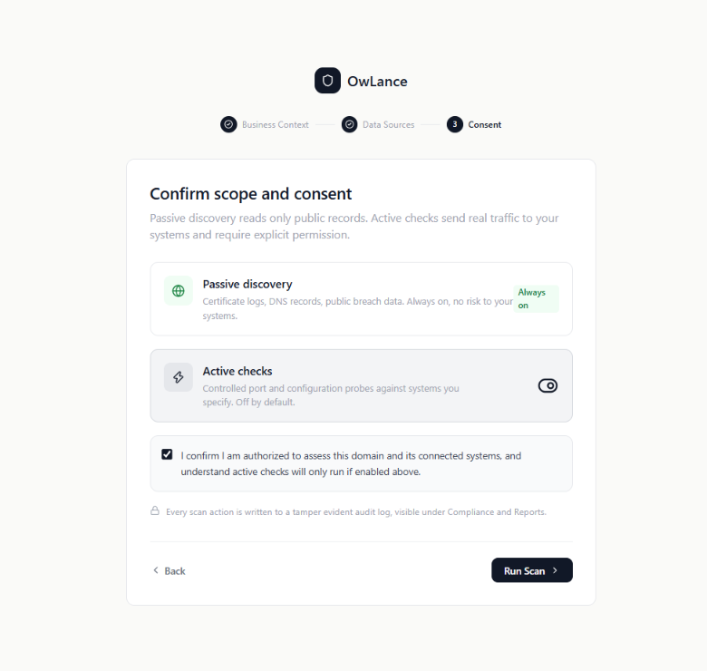
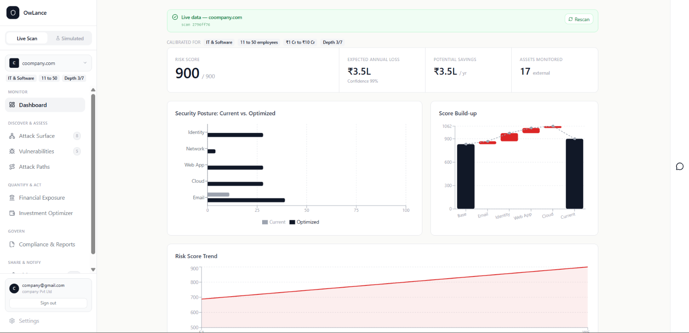
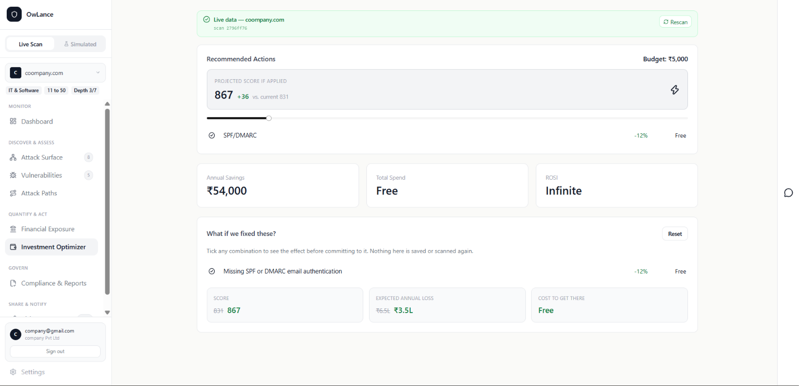
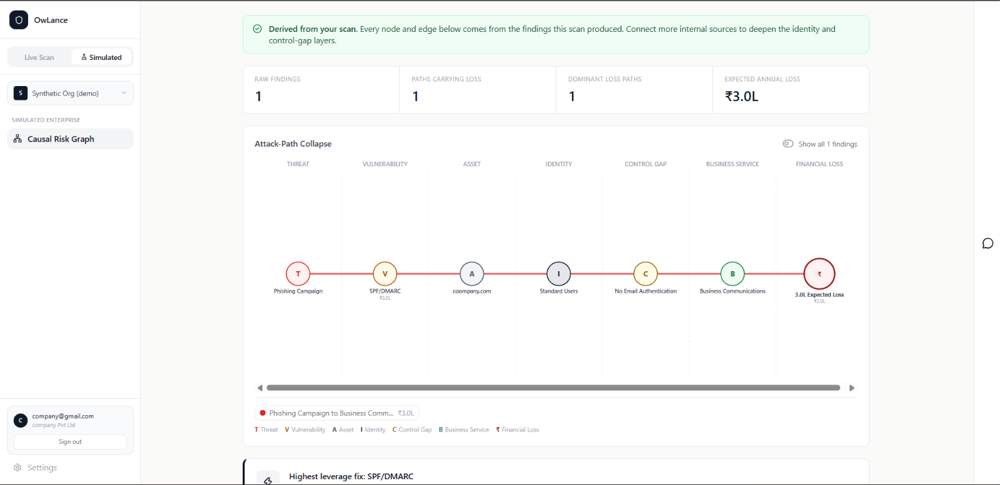
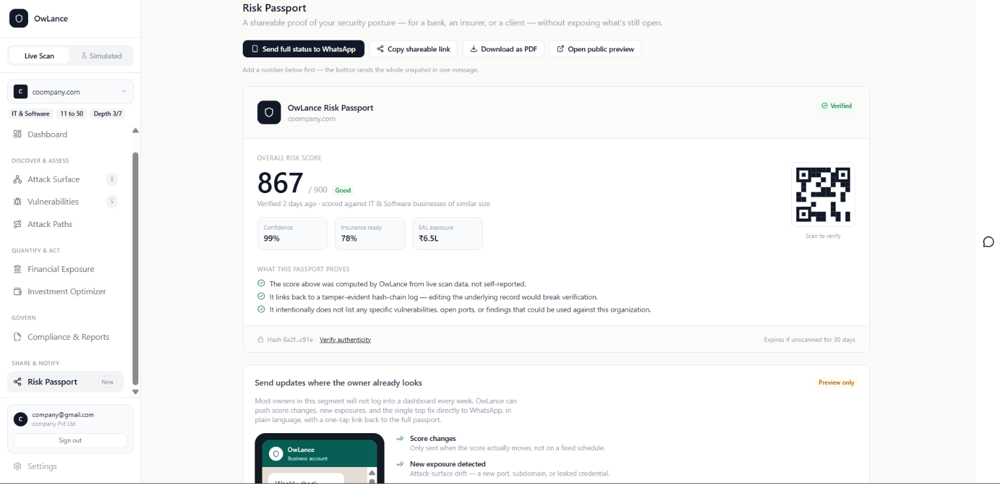

# 🦉 OwLance

**AI-powered continuous cyber risk quantification and investment optimization.**
Turn security findings into **rupees at risk** and a **budget-ranked fix plan**, then prove your posture with a shareable, tamper-evident **Risk Passport**.

> Smart India Hackathon 2026 · **PS ID 26105** · AICTE (Cyber Security Cell) · Theme: Blockchain & Cybersecurity · Category: Software


**Quick links:** [Why OwLance](#-the-problem) · [PS 26105 mapping](#-how-owlance-answers-ps-26105) · [Features](#-features) · [How it works](#-how-it-works) · [Run locally](#-running-locally) · [Walkthrough](docs/WALKTHROUGH.md)

---

## 🎯 The Problem

Most cyber risk tools say **Low / Medium / High**. That tells a CISO or a small-business owner nothing about how much money is at stake, or where a limited security budget should go first.

## 💡 Our Solution

OwLance converts technical findings into **rupee-denominated risk** and a **ranked, budget-constrained investment plan**. It keeps monitoring continuously, so the numbers move as your exposure moves.



Both **technical and non-technical users** can operate it, and the business gets a **Risk Passport**: proof of its security posture that it can hand to a bank, insurer or client without exposing what is still open.

📖 **[Step-by-step walkthrough with screenshots →](docs/WALKTHROUGH.md)**

---

## ✅ How OwLance answers PS 26105

| PS 26105 asks for | What OwLance delivers | Where to see it |
|---|---|---|
| **Continuous** risk quantification | Scheduled rescans, drift detection and score-change alerts ([details](#-continuous-monitoring)) | Dashboard, Rescan, WhatsApp alerts |
| Risk in **financial terms** | 0–900 score plus Expected Annual Loss with median / P90 / P99 range and a confidence score | Dashboard, Financial Exposure |
| **Investment optimization** | Budget slider, greedy-ratio knapsack optimizer, ROSI per fix, free fixes first | Investment Optimizer |
| **AI-powered** | EPSS exploit-probability model drives likelihood; an LLM Risk Copilot explains results in plain English | Risk Matrix, Risk Copilot |
| **Blockchain** theme | Hash-chained, tamper-evident audit log and Risk Passport | Compliance & Reports, Risk Passport |

---

## 👥 One engine, two audiences

Cyber risk usually lives in a tool only a security engineer can read, while the person who approves the budget never sees it. OwLance serves both from the **same deterministic engine**: the numbers never change between views, only the level of detail does.

| | Owner / management | Security & IT team |
|---|---|---|
| **Goal** | "How much money is at risk and what should I spend?" | "What exactly is exposed and how do I fix it?" |
| **Sees** | One 0–900 score, Expected Annual Loss in ₹, potential savings | Impact × Likelihood risk matrix, EPSS-driven likelihood, CVE data |
| **Asks** | Risk Copilot: "What is our highest financial risk today?" | Attack-Path Collapse: Threat → Vulnerability → Asset → Identity → Control Gap → Business Service → Financial Loss |
| **Decides** | Drags the budget slider; sees which fixes are worth doing, free fixes first, with ROSI | Works the ranked fix list; uses compliance mapping (NIST CSF, ISO 27001, CIS, RBI, SEBI CSCRF) and the REST API |
| **Shares** | Sends the Risk Passport to a bank, insurer or client over WhatsApp, no dashboard login needed | Exports reports and audit logs; integrates via the FastAPI Swagger / ReDoc docs |

---

## 🖼️ What it looks like


*Consent-first by design: active scanning runs only after explicit, logged authorization, and every scan action is written to a tamper-evident audit log.*


*One score (0–900), Expected Annual Loss and potential savings, all computed live from a real scan, not placeholder data.*


*Drag the budget slider and a greedy-ratio knapsack recalculates which fixes to prioritize, free fixes first.*


*Attack-Path Collapse: Threat → Vulnerability → Asset → Identity → Control Gap → Business Service → Financial Loss. The graph starts sparse on an external-only scan and fills in as more data sources connect.*

### 🛡️ The Risk Passport: why OwLance is different



Most tools score a company in secret, for the vendor's own dashboard. The Risk Passport flips that. It is a **shareable, verifiable proof of security posture**, owned and controlled by the business, backed by a tamper-evident hash chain, and deliverable straight to WhatsApp. An owner can prove their posture to a bank, insurer or client without logging into anything, and without revealing what is still open. It turns a risk score into something the business can *use*, not just look at.

More screens (onboarding, live scanning, the vulnerability risk matrix, the API docs) are in the **[full walkthrough](docs/WALKTHROUGH.md)**.

---

## 🚀 Features

| Feature | What it does |
|---|---|
| **Consent-first scanning** | Active checks run only after explicit, logged authorization. Passive discovery is always on. |
| **Risk Score** | 0–900 composite score and Expected Annual Loss, calibrated to sector- and size-matched breach-cost benchmarks. |
| **Risk Matrix** | Every finding on an Impact × Likelihood grid, with EPSS driving the likelihood axis. |
| **Causal risk graph + ROSI** | Adaptive Threat → Vulnerability → Asset → Identity → Control Gap → Business Service → Financial Loss chain. |
| **Investment optimizer** | Greedy-ratio knapsack under a budget slider, free fixes first, ROSI per recommendation. |
| **Risk Copilot (AI)** | Plain-English chat for non-technical owners. It only explains numbers the deterministic engine already computed; it never generates a score or a finding. |
| **Risk Passport** | Hash-chained proof of posture with QR verification, PDF download, public preview and WhatsApp delivery. |
| **Compliance & Reports** | Findings mapped to NIST CSF, ISO 27001, CIS Controls, RBI Guidelines and SEBI CSCRF, backed by the audit log. |
| **REST API** | FastAPI backend with auto-generated Swagger / ReDoc docs. |

---

## 🔁 Continuous monitoring

"Continuous" means OwLance never produces a one-time report. It keeps the score current.

| Capability | How it works |
|---|---|
| **Passive discovery** | Always on. Reads public records only: certificate transparency logs (crt.sh), DNS, public breach data. |
| **Rescan schedule** | `[FILL: e.g. every 24 hours / on demand / configurable]` |
| **Drift detection** | Each scan is diffed against the previous one. New subdomains, open ports or leaked credentials count as new exposure. |
| **Alerts** | A WhatsApp message is sent **only when the score moves** or a new exposure appears, not on a fixed schedule. Threshold: `[FILL: e.g. ±N points]` |
| **Trend** | The dashboard's Risk Score Trend chart shows posture over time. |
| **Connectors** | `[FILL: list connectors in backend/app/routers/connectors, e.g. cloud, email, identity]`. More connected sources make the causal graph denser and the loss estimate tighter. |

---

## ⚙️ How it works

1. **Deterministic core, AI explains.** The scoring engine and optimizer are rule-based and fully auditable. No LLM ever generates a risk number; the Risk Copilot only translates numbers the engine already computed.
2. **Consent-first, passive-first.** Active scanning requires explicit, logged authorization. Passive discovery is always on.
3. **Statistically honest.** Financial exposure is always a range (median / P90 / P99) with a confidence score, never one fake-precise number.
4. **Benchmark-driven.** Small businesses can't hand-calibrate FAIR-style probability inputs, so financial modeling uses sector- and size-matched breach-cost benchmarks.
5. **One adaptive engine, not two tiers.** The causal risk graph starts sparse (external-only) and fills in as more sources connect. There is no separate "SME edition" and "enterprise edition."

### Where AI is used (and where it is not)

| Task | Method | Why |
|---|---|---|
| Exploit likelihood | FIRST.org **EPSS** (ML-based exploit prediction) | Data-driven, refreshed by FIRST |
| Plain-English explanation | LLM **Risk Copilot** | Makes results usable for non-technical owners |
| Risk score, loss estimate, optimization | **Deterministic, rule-based** | Must be auditable, because it decides real money |

> **No LLM ever generates a risk number.**

---

## 📁 Project structure

```
owlance/
├── src/                        # Frontend (React + Vite)
│   ├── App.jsx
│   ├── OwLance.jsx
│   ├── components/
│   ├── lib/
│   └── assets/
├── public/                     # Static assets
├── backend/                    # Backend (FastAPI + Python)
│   ├── app/
│   │   ├── main.py             # FastAPI application
│   │   ├── config.py
│   │   ├── db/                 # SQLAlchemy models + session
│   │   ├── routers/            # auth, scan, consent, optimizer,
│   │   │                       #   connectors, analytics, whatsapp
│   │   ├── schemas/            # Pydantic schemas
│   │   └── services/           # Scoring, optimizer, scanners, threat intel
│   ├── tests/                  # Pytest suite
│   ├── requirements.txt
│   └── .env.example
├── scripts/                    # Build / smoke-test helpers
├── docs/                       # Walkthrough + screenshots
├── run.ps1 / run.sh            # One-command local startup
├── vite.config.js
└── package.json
```

---

## 🛠️ Running locally

**Windows (PowerShell):**

```powershell
git clone https://github.com/ramyakg6/SIH_OWLANCE.git
cd SIH_OWLANCE
Set-ExecutionPolicy -Scope Process -ExecutionPolicy Bypass
.\run.ps1
```

**macOS / Linux:**

```bash
git clone https://github.com/ramyakg6/SIH_OWLANCE.git
cd SIH_OWLANCE
chmod +x run.sh && ./run.sh
```

| Service | URL |
|---|---|
| Frontend | http://localhost:5173 |
| API docs (Swagger) | http://127.0.0.1:8000/docs |

The script creates the backend virtual environment, installs frontend dependencies and starts both servers.

**Zero-setup demo:** `backend/.env.example` seeds a demo account on first boot, so a fresh clone is usable immediately.

| Email | Password |
|---|---|
| `demo@owlance.in` | `owlance2026` |

The database falls back to SQLite automatically if PostgreSQL isn't configured. Demo credentials are for local use only; change them before any shared deployment.

---

## 🔧 Technology stack

| Layer | Tech |
|---|---|
| **Backend** | FastAPI (async API), SQLAlchemy (PostgreSQL, automatic SQLite fallback), Pydantic (validation and settings), PyJWT (session tokens) |
| **Frontend** | React 19, Vite, Tailwind CSS, Recharts (score build-up, risk trend, loss exceedance curve) |
| **Data sources** | **crt.sh** (certificate transparency, passive subdomain discovery), **NVD** (CVE data), **FIRST.org EPSS** (exploit probability) |

---

## 🧪 Testing and code quality

```bash
# Backend
cd backend && pytest -q

# Frontend (run from the repo root, where package.json lives)
npm test
```

| Check | Backend | Frontend |
|---|---|---|
| Lint | `ruff check .` | `npm run lint` |
| Format | `ruff format .` | `prettier --write .` |
| Types | `mypy .` | `npm run type-check` |

---

## ⚠️ Scope and limitations

- Without connectors, the scan is **external-only**, so the causal graph and loss estimate are sparser and the confidence score is lower. Connecting more sources tightens both.
- Financial figures are **benchmark-based estimates** shown as ranges, not guarantees of loss.
- The causal graph screenshot is labelled *Simulated* because it illustrates the fully-connected state.
- `[FILL: add any other known limits, e.g. rate limits on public data sources, supported WhatsApp provider, languages]`

---

